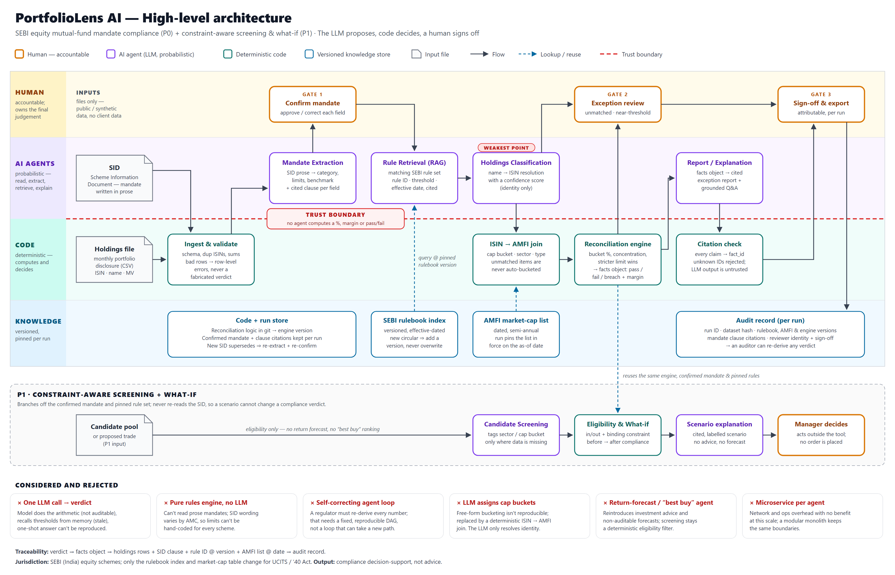

# PortfolioLens AI — Architecture

Source: [PortfolioLens_Architecture.svg](PortfolioLens_Architecture.svg) (editable, scales cleanly) · [PNG](PortfolioLens_Architecture.png) (for the brief). Based on [PRD v0.3](../PortfolioLens_AI_PRD_v0.3.md).

## What the Tresata brief asks of the architecture — and where the diagram answers it

| Brief asks for | Where it is on the diagram |
|---|---|
| Architecture diagram showing **where the human and the AI each act** | Swimlanes: **Human** (3 gates), **AI agents** (probabilistic), **Code** (deterministic), **Knowledge** (versioned stores) |
| **Alternatives you rejected and why** | "Considered and rejected" row, six alternatives with reasons |
| One LLM call, or retrieval / rules engine / calculator / several agents / a mix — **why that combination?** | The lanes *are* the answer: LLM only where prose must be read (SID, explanation), RAG for rules, deterministic code for every number; single-call option shown as rejected |
| Which parts must be **exact and auditable** vs **probabilistic** — how kept apart? | Red **trust boundary**: no agent computes a %, margin or pass/fail. Citation check re-validates LLM output in code |
| **Where knowledge lives**, and what happens when it's **no longer valid** | Knowledge lane: SID → re-extract on a new SID; rulebook → add a version, never overwrite; AMFI list → pinned to as-of date; logic → engine version; final judgement → the human |
| Can every output be **traced back to its source**? | Audit record + footer chain: verdict → facts object → holdings rows + SID clause + rule ID@version + AMFI list@date |
| **Weakest point** and what would break it | "Weakest point" tag on Holdings Classification (ISIN resolution near a cap-bucket boundary); mitigations are Gate 2 + "never auto-bucketed" |
| Legal/advice constraint: **who is accountable**, qualified human in the loop | Gate 1 (confirm mandate), Gate 2 (exception review), Gate 3 (attributable sign-off); P1 ends with "Manager decides, no order placed" |
| Jurisdiction covered and what changes for another | Footer: SEBI equity only; swap rulebook index + market-cap table for UCITS / '40 Act |

## How to read it

**P0 — compliance check (the spine).** Holdings CSV + SID are validated in code → the Mandate Extraction agent proposes a mandate with a cited clause per field → **Gate 1**: a human confirms it → a fixed LangGraph workflow retrieves the matching SEBI rules from the pinned local rulebook, classifies holdings against the dated security master, reconciles constraints in deterministic code, writes a cited report, and persists the run → **Gate 2**: unmatched holdings and near-threshold verdicts go to a human → **Gate 3**: sign-off and audit record. The API keeps all human gates explicit; the graph runs only after Gate 1 and has no loops.

The current prototype's LangGraph nodes are `load_confirmed_inputs → retrieve_rules_and_references → classify_holdings → reconcile_constraints → write_cited_report → persist_run`. The retrieval node first selects the date-effective rulebook and pins its hash, then runs a LangChain `BaseRetriever` over only that version's rules applicable to the confirmed category plus global rules. The optional model can reorder the complete retrieved ID set; the application rejects any omitted, duplicate, or unknown IDs and keeps deterministic lexical order if the model fails or returns invalid data. Numeric calculations and pass/breach decisions remain in the deterministic engine. Every run stores the selected version, effective date, hash, query, retrieval method, and applied rule IDs. This prototype uses lexical retrieval, not embeddings or a vector database, and its paraphrased rule texts still require authoritative verification. Mandate extraction happens before Gate 1 through its API/UI step; sign-off happens after the graph.

**P1 — screening + what-if.** Branches off the *confirmed* mandate and pinned rules and reuses the same engine. It never re-reads the SID, so a scenario can't change a compliance verdict. Output is eligibility and before/after compliance, never a forecast or recommendation; the manager acts outside the tool.

## Not on the diagram — must be covered in the brief's text

- **Risks** section (wrong answers, outdated rules, confidential data, liability) — the diagram shows the mitigations, but the brief asks for each risk to be named explicitly. Use PRD §9.
- **Problem statement** numbers (who / task / how often / cost today) and **why now** (Feb 2026 SEBI circular) — PRD §3.1.
- **Appendix: "what you added beyond the AI"** — one page, separate from the diagram.
- **What to consider before spending more time** — e.g. validate the cost-today assumption with a compliance practitioner, and check exact thresholds against the SEBI circular and current AMFI list.
